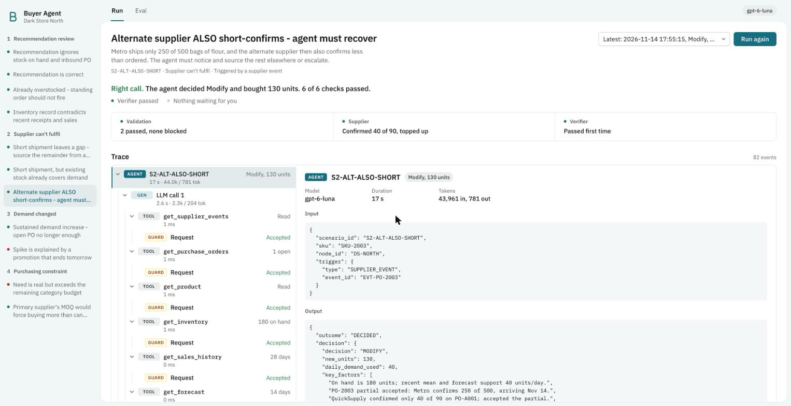
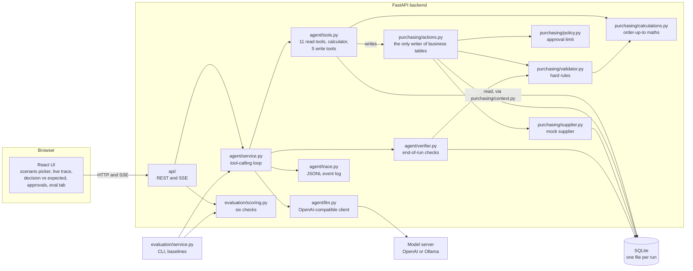

# AI Buyer Agent

An AI purchasing agent for a quick-commerce company.
It takes a purchasing situation (a replenishment recommendation, a supplier message, or a demand alert), investigates the data, decides what to do, acts on purchase orders, and then checks that its action actually worked.

The model proposes, deterministic code disposes.
The language model investigates, judges and explains.
Plain Python does the arithmetic and enforces every business rule, and the model cannot bypass it.



This repository contains the full stack:

- a mock purchasing world (SQLite, 11 scenarios with hand-worked ground truth),
- a mock supplier API that can disagree with its own catalog,
- the agent (a hand-written tool-calling loop over any OpenAI-compatible model),
- the guardrails (validator, approval policy, end-of-run verifier),
- an evaluation harness that scores every run on the six questions the assignment asks,
- a FastAPI backend and a React UI to watch a run live and approve or reject held purchase orders.

Start with [Quick start](#quick-start) to see it running in about a minute without a model or an API key.

## Contents

- [Quick start](#quick-start)
- [Running with a real model](#running-with-a-real-model)
- [Architecture](#architecture)
- [How decisions are validated: three feedback loops](#how-decisions-are-validated-three-feedback-loops)
- [Scenarios](#scenarios)
- [Evaluation and results](#evaluation-and-results)
- [Key design decisions](#key-design-decisions)
- [Limitations and next steps](#limitations-and-next-steps)
- [Repository layout](#repository-layout)
- [Tests](#tests)

Deeper documents:

- [docs/architecture.md](docs/architecture.md): components, write pipeline, agent loop, data model, API.
- [docs/approach.md](docs/approach.md): how the problem was broken down and how decisions are made.
- [docs/evaluation.md](docs/evaluation.md): the six checks, ground truth, baselines, results and findings.
- [docs/demo.md](docs/demo.md): a three-minute walk-through.

## Quick start

Requirements: Python 3.11 or newer with [uv](https://docs.astral.sh/uv/), and Node.js 20.19 or newer (22.12 or newer also works) with npm.

Demo mode drives the API with a deliberately naive "rubber stamp" policy instead of a language model.
It needs no model, no GPU and no key, and the UI shows a "Demo: rubber-stamp policy" badge so nobody mistakes it for the agent.
The system around the policy is real: the same tools, validator, write pipeline, verifier and scorer run on every demo click.

### Option A: one process (UI served by the backend)

```bash
cd frontend && npm ci && npm run build
cd ../backend && uv sync
LLM_MODEL=baseline:rubber_stamp uv run uvicorn app.main:app --port 8000
```

Open http://localhost:8000.
Build the UI before starting the server: the backend serves `frontend/dist` only if it exists when the server starts.

### Option B: backend and Vite dev server (two terminals)

```bash
# terminal 1
cd backend
uv sync
LLM_MODEL=baseline:rubber_stamp uv run uvicorn app.main:app --port 8000
```

```bash
# terminal 2
cd frontend
npm ci
npm run dev
```

Open http://localhost:5173.
The dev server proxies `/api` to http://localhost:8000.
If the backend runs on another port, start the dev server with `BACKEND_URL=http://localhost:<port> npm run dev`.

### Try it

1. Pick a scenario in the sidebar and press Run.
2. Watch the trace stream in, then compare the decision with the expected answer and read the six checks.
3. Open the Eval tab to see the committed evaluation reports side by side.

In demo mode most scenarios end with a failed check, which is the point: the rubber stamp is the thing the evaluation must tell apart from a good agent.
See [docs/demo.md](docs/demo.md) for what to look at.

### Other commands (no model needed)

```bash
cd backend
uv run buyer-seed                              # list the 11 scenarios
uv run buyer-seed S1-MODIFY                    # build a fresh database for one scenario in backend/data/runs/
uv run buyer-eval --baseline rubber_stamp --out /tmp/eval-demo   # score a baseline on all 11 scenarios
uv run pytest -q                               # run the tests
```

The command-line runner `uv run buyer-run <scenario id>` prints the live trace.
With `LLM_MODEL=baseline:rubber_stamp` it runs the demo policy, otherwise it talks to the configured model (see below).

## Running with a real model

The agent talks to any OpenAI-compatible Chat Completions endpoint.
Switching model or provider is an environment change, never a code change.
Copy `.env.example` to `.env` in the repository root and edit it, or export the variables in your shell.
`.env` is git-ignored.

| Variable | Meaning | Default |
|---|---|---|
| `LLM_BASE_URL` | Endpoint of the model server | `https://api.openai.com/v1` |
| `LLM_API_KEY` | API key; may be any non-empty string for a local server | none (required unless the URL is `localhost` or `127.0.0.1`) |
| `LLM_MODEL` | Model name (required, there is no default) | none |
| `LLM_TEMPERATURE` | Sampling temperature; leave unset for models that only accept their default | not sent (the evaluator uses 0 unless this is set) |
| `LLM_TIMEOUT_S` | Seconds to wait for one model reply; thinking models may need 300 or more | 120 |
| `LLM_MAX_TOKENS` | Cap on tokens per model reply, so a model that never stops cannot hang a run | 4096 |
| `LLM_REASONING_EFFORT` | Sent as `reasoning_effort`; some OpenAI reasoning models only call tools on Chat Completions with `none` | not sent |

### Local model with Ollama

Ollama's default context window is 4096 tokens, which is smaller than the agent's first prompt, so the server would silently cut the start of the conversation and the model would never see its instructions.
The Modelfile in `ollama/` raises the window to 32768 tokens.

```bash
ollama pull qwen3.5:4b
ollama create buyer-qwen3.5-4b -f ollama/Modelfile.qwen3.5-4b
```

Then put this in `.env`:

```bash
LLM_BASE_URL=http://localhost:11434/v1
LLM_API_KEY=ollama
LLM_MODEL=buyer-qwen3.5-4b
LLM_TEMPERATURE=0
```

If a reply times out on a slow machine, raise `LLM_TIMEOUT_S` (see the table above).
If the server still cuts the prompt, the run stops with outcome `CONTEXT_TRUNCATED` and a message instead of letting a blind model act.

### OpenAI

```bash
LLM_BASE_URL=https://api.openai.com/v1
LLM_API_KEY=<your key>
LLM_MODEL=<openai-model>
```

### Run the agent

With the variables set, start the backend without the `LLM_MODEL=baseline:...` prefix and use the UI exactly as in demo mode:

```bash
cd backend
uv run uvicorn app.main:app --port 8000
```

Or run one scenario from the command line and watch the trace:

```bash
cd backend
uv run buyer-run S1-MODIFY
```

Or evaluate a model on all 11 scenarios, three repeats each, and write the report to `docs/eval/`:

```bash
cd backend
uv run buyer-eval --model buyer-qwen3.5-4b --repeats 3
```

## Architecture



Every box on the left of the model is deterministic code.
The model only ever sees tool schemas and tool results, and the only door into the purchase-order table is `purchasing/actions.py`.
[docs/architecture.md](docs/architecture.md) has the write-pipeline sequence diagram, the agent-loop flowchart, the data model and the API.

## How decisions are validated: three feedback loops

The assignment asks how the system can tell that a purchase order is actually acceptable and what happens when the outcome differs from what the agent expected.
There are three loops, each catching a different kind of mistake.

| Loop | When it runs | What it catches | What the agent gets back |
|---|---|---|---|
| 1. Pre-action validation | Before a PO is written | The agent proposes something illegal (case pack, MOQ, budget, storage, shelf life, unapproved supplier) | Every violation at once, with the numbers and the largest legal quantity |
| 2. Post-action outcome check | After the PO is submitted to the supplier | The world did not do what the agent expected (the supplier confirms less than asked) | The supplier's real answer: confirmed quantity, status and shortfall |
| 3. End-of-run verification | When the agent calls `submit_decision` | The overall result does not hold up when recomputed from the final database | A list of findings, once; a second failure flags the run for a human |

Guards around the loops: warnings (unusual but legal) need a written justification before anything is written, a PO above $2,000 waits for a human and the supplier is not contacted until it is approved, and the same failed write three times locks all writes except `escalate_to_human`.

### A real example

These excerpts come from a development run of a small local model on S2-ALT-ALSO-SHORT (run id `20261111T191342-424b30`).
The catalog says QuickSupply can supply 1,000 units, but the hidden live availability is 40.

Loop 2: the agent orders from the alternate supplier and the supplier answers short.

```text
create_po {"supplier_id": "SUP-QUICK", "qty": 180, "daily_demand": 40, "sku": "SKU-2003", ...}
  -> status WRITTEN, supplier PARTIALLY_CONFIRMED, shortfall 140
     "Supplier confirmed only 40 of 180 units of PO-A001 (short by 140)."
```

Loop 3: the agent escalates, then submits a decision that does not match the database.

```text
submit_decision {"decision": "REJECT", "new_units": 0, ...}
  -> CLAIM_MISMATCH: submit_decision says new_units=0, but the database expects 40 units
     to arrive from the POs you created or increased
  -> DECISION_ACTION_MISMATCH: The decision is REJECT but 40 new units were bought.
submit_decision {"decision": "MODIFY", "new_units": 40, ...}
  -> Decision recorded. Verification passed.
```

The loops did their job: the shortfall was surfaced in the tool result and the false claim was caught and corrected.
The model's judgement was weaker: it escalated instead of topping up from Rapido, so the action check (which expects 90 to 220 new units) would still fail this run.
That is the intended split, the guardrails keep the system honest and the evaluation measures the judgement.
More excerpts, including a blocked write, are in [docs/architecture.md](docs/architecture.md#three-feedback-loops).

## Scenarios

The four assignment scenarios are implemented as 11 variants of one world.
Every scenario has hand-worked numbers and an expected answer written as a band, not a single quantity, because reasonable buyers differ.
Five of the 11 scenarios expect ACCEPT, REJECT or INVESTIGATE instead of a modification, so an agent that always changes the plan cannot score well.
There is no scenario-specific code: a scenario is only data and a trigger.

| Scenario | Group | Title | Expected decision | New-buy band (units) | What it tests |
|---|---|---|---|---|---|
| `S1-MODIFY` | 1 Recommendation review | Recommendation ignores stock on hand and inbound PO | MODIFY | 168 to 240 | The engine ignores stock on hand and an inbound PO, so 800 units is far too much and would also break free storage. The right order is a few cases that cover the net need. |
| `S1-ACCEPT` | 1 Recommendation review | Recommendation is correct | ACCEPT | 456 to 504 | The recommendation is correct (a whole number of cases, inside budget and storage). The agent must verify it and not invent a change. |
| `S1-REJECT` | 1 Recommendation review | Already overstocked - standing order should not fire | REJECT | 0 | A fixed standing order of 480 (a valid PO on its own) fires although stock plus inbound already cover about five weeks. Nothing should be bought. |
| `S1-INVESTIGATE` | 1 Recommendation review | Inventory record contradicts recent receipts and sales | INVESTIGATE and an INVESTIGATION escalation | 0 | The inventory record says zero, but a delivery two days ago and continued sales contradict it. The agent should request a count and not buy on a record it cannot trust. |
| `S2-SOURCE-ELSEWHERE` | 2 Supplier cannot fulfil | Short shipment leaves a gap - source the remainder from an alternate | MODIFY | 90 to 220 | The primary supplier ships half of a PO and has nothing more. The gap must come from an approved, fast alternate. Traps: the cheapest supplier is not approved, and another is cheap but slow and unreliable. |
| `S2-ACCEPT-SHORT` | 2 Supplier cannot fulfil | Short shipment, but existing stock already covers demand | ACCEPT | 0 | Same short shipment, but existing stock already covers demand. Accept the partial confirmation and buy nothing. |
| `S2-ALT-ALSO-SHORT` | 2 Supplier cannot fulfil | Alternate supplier ALSO short-confirms - agent must recover | MODIFY | 90 to 220 | The alternate's catalog says 1,000 units, but it confirms only 40. The agent must notice the shortfall in the supplier's answer and cover the rest from another approved supplier. Exercises loops 2 and 3. |
| `S3-SUSTAINED-SPIKE` | 3 Demand changed | Sustained demand increase - open PO no longer enough | MODIFY | 180 to 650 | Sales rose steadily to about two and a half times the forecast with no promotion. The open PO is no longer enough, so the plan must change. |
| `S3-PROMO-ENDING` | 3 Demand changed | Spike is explained by a promotion that ends tomorrow | ACCEPT | 0 | The spike is explained by a promotion that ends tomorrow. Do not extrapolate it. |
| `S4-BUDGET` | 4 Purchasing constraint | Need is real but exceeds the remaining category budget | MODIFY and a BUDGET_INCREASE escalation | 120 to 396 | The need is real but the category budget allows only part of it. Buy what fits, raise a budget escalation for the rest, and note the PO is above the approval limit so a human approves it. |
| `S4-MOQ-VS-SHELF-LIFE` | 4 Purchasing constraint | Primary supplier's MOQ would force buying more than can sell before expiry | MODIFY | 36 to 72 | The primary supplier's MOQ would force a purchase that cannot sell before the shelf life ends. A different approved supplier with a small MOQ is the better buy. |

Groups: 1 is recommendation review, 2 is supplier cannot fulfil, 3 is demand or forecast changed, 4 is purchasing constraint.
The new-buy band is the number of units expected to arrive from POs the agent creates or increases.

## Evaluation and results

Each run is scored by deterministic code on the six questions the assignment lists: was the decision correct, did it get the necessary information, did it respect constraints, did it take the appropriate action, did it validate the result, and what happened when the first action did not work.
Every check carries a written reason with the numbers.
Two deliberately dumb baselines (`rubber_stamp` and `do_nothing`) are scored by the same code to prove the evaluation can tell good behaviour from bad.

<!-- RESULTS:START -->
Generated from the JSON reports in `docs/eval/`.
Check columns show passed runs over runs where the check applied.
A scenario passes only when every repeat passes.

| Name | Kind | Runs | Scenarios passed | Runs passed | decision | information | constraints | action | validation | recovery |
|---|---|---|---|---|---|---|---|---|---|---|
| [gpt-6-luna](docs/eval/gpt-6-luna.md) | model | 33 (11 x 3) | 9/11 | 29/33 | 30/33 | 33/33 | 33/33 | 31/33 | 32/33 | 6/6 |
| [rubber_stamp](docs/eval/rubber_stamp.md) | baseline | 11 | 0/11 | 0/11 | 3/11 | 0/11 | 11/11 | 3/11 | 5/11 | 0/4 |
| [do_nothing](docs/eval/do_nothing.md) | baseline | 11 | 0/11 | 0/11 | 1/11 | 0/11 | 11/11 | 3/11 | 4/11 | n/a |

The hosted model passes 9 of 11 scenarios on every repeat, and both baselines pass none.
It fails S3-PROMO-ENDING in every repeat: it names the promotion that ends tomorrow, then orders at the promotional rate.
S4-BUDGET passes in 2 of 3 runs; the third escalated the budget shortfall, bought only after the verifier pushed back, and bought too little.
Both are judgement failures, not rule breaks: `constraints` is 33 of 33.
[docs/evaluation.md](docs/evaluation.md#what-the-real-runs-taught-us) walks through both.
<!-- RESULTS:END -->

Full per-scenario reports, with a reason for every failed check and the run ids, are in [docs/eval/](docs/eval/).
[docs/evaluation.md](docs/evaluation.md) explains each check, how to read the table, what the real runs taught us, and how to run the same evaluation on a model.

## Key design decisions

1. **One general agent, scenarios are data.** There is no Scenario 2 handler: a scenario is a database plus a trigger, and the prompt never names a scenario, SKU, supplier or answer (a test enforces it).
2. **The model proposes, code disposes.** Quantities, cover days and limits come from a calculator tool and every write passes a validator the model cannot bypass.
3. **Judgement stays with the model, arithmetic with code.** The agent chooses which daily demand to plan for, and `plan_order` does the order-up-to maths for that choice.
The prompt does not tell it which demand to pick.
4. **One door for writes.** Create, modify, accept, cancel, approve and reject all go through `purchasing/actions.py`: validate, justify, approve, write, submit, audit, in one transaction.
5. **Errors block, warnings need a justification.** Hard rules stop the write; judgement calls (excess cover, arriving after a stockout, an unreliable supplier) are written only with a stated reason that lands in the audit log.
6. **Legal is not the same as authorised.** A valid PO above $2,000 is held for a human and the supplier is not contacted until it is approved.
7. **The supplier's answer is the truth.** The validator cannot see the supplier's live availability, so a short confirmation is a real surprise the agent must observe and handle.
8. **The verifier trusts the database, not the model's story.** It recomputes what will arrive, re-validates every touched PO and looks for an unresolved gap, then gives the agent one chance to fix findings before a human is flagged.
9. **The model runs the loop.** It gets the trigger and the tools, and decides what to read.
Nothing is preloaded, and the prompt teaches no scenario-specific rules, so the evaluation measures the agent rather than the prompt author.
10. **Bounded retries.** The same failed write three times locks writes, which forces escalation instead of an endless loop.
11. **Reproducible world.** A fresh SQLite file per run and a frozen clock (2026-11-11) mean repeats and model comparisons start from identical data.
12. **Deterministic evaluation, baselines included.** Ground truth is a band, every do-nothing variant is a scenario, and the dumb baselines are scored by the same code; there is no model judge.

## Limitations and next steps

Honest limits of this submission:

- **One node and one SKU per run, one SKU per PO.** Real purchase orders have many lines and real buyers reason across nodes.
- **Flat forecast.** The forecast is a constant per day, so weekly seasonality and trend are not modelled.
- **Storage in units.** Capacity is counted in units per zone, not pallets or volume, and other SKUs are one number.
- **Order-up-to safety stock in days.** There is no statistical safety stock (no service level or demand variance).
- **Small-model reliability.** A local model of about 4 billion parameters fails several scenarios, write tool calls as text, and sometimes claim an action they did not take; the guardrails catch this, but they cannot supply judgement.
- **No authentication.** The API is open and CORS allows only the Vite dev origin.
- **Demo-scale infrastructure.** One thread per run, an in-process registry, SQLite files on disk, no queue or workers.
- **The approval flow cannot be shown in demo mode** because the rubber stamp never produces a valid PO above the approval limit.

Next steps:

- multi-SKU purchase orders and stock transfers between nodes as an alternative to buying,
- statistical safety stock and a real forecast with seasonality,
- an LLM judge for explanation quality, calibrated against hand-graded runs,
- a model comparison between the local model and an OpenAI model using the same evaluation (the commands are ready, see above).

## Repository layout

```text
.
|-- README.md
|-- .env.example                 environment variables for the model endpoint
|-- docs/
|   |-- architecture.md          components, pipelines, data model, API
|   |-- approach.md              problem breakdown and decision logic
|   |-- evaluation.md            checks, ground truth, baselines, results, findings
|   |-- demo.md                  three-minute walk-through
|   |-- eval/                    generated reports (JSON and Markdown) per model or baseline
|   `-- images/                  screenshots used by the docs
|-- ollama/                      Modelfile that raises the context window to 32768 tokens
|-- backend/
|   |-- pyproject.toml, uv.lock
|   |-- app/
|   |   |-- main.py              entry point: loads .env, builds the FastAPI app (uvicorn app.main:app)
|   |   |-- config.py, db.py, serialize.py, schema.sql   settings, SQLite and the frozen clock, JSON helpers
|   |   |-- purchasing/          the business core: read model, calculations, validator, policy, mock supplier,
|   |   |                        and actions.py, the write pipeline
|   |   |-- agent/               tool-calling loop, prompts, model client, verifier, trace, run storage, the 17 tools
|   |   |-- scenarios/           the 11 scenarios, their triggers and expected answers, the mock-world builder
|   |   |-- evaluation/          scoring, evaluation service, reports, baselines
|   |   |-- api/                 FastAPI routes, SSE stream, approvals, serves the built UI
|   |   `-- cli/                 buyer-run, buyer-seed, buyer-eval, buyer-llm-smoke
|   |-- tests/                   unit and integration tests, scripted fake model, no network
|   `-- data/                    runtime output (git-ignored): databases, traces
`-- frontend/                    Vite, React, TypeScript, Tailwind
```

## Tests

```bash
cd backend
uv sync
uv run pytest -q
```

The tests use a scripted fake model and in-memory databases, so they need no network and no key.
The live-model smoke tests are skipped unless `LLM_LIVE=1` is set (they call whatever model `.env` points at).
The frontend type-checks with `cd frontend && npm run typecheck`.
