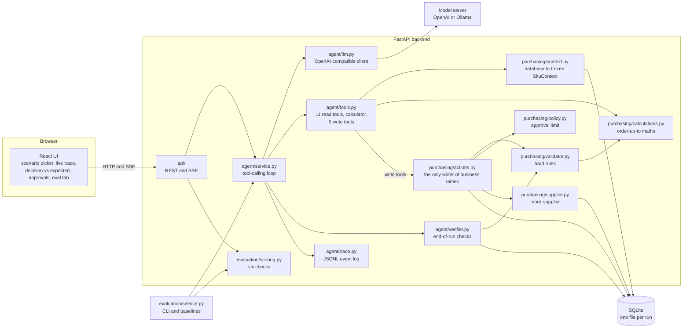
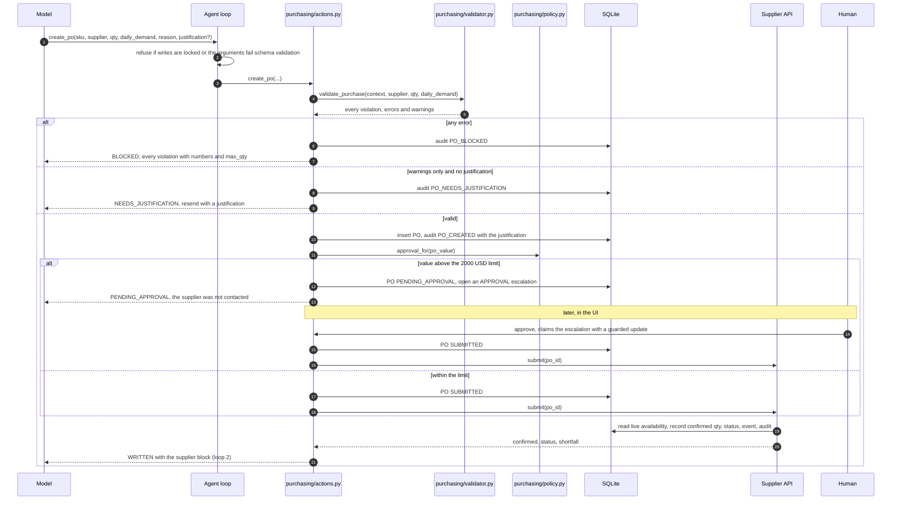
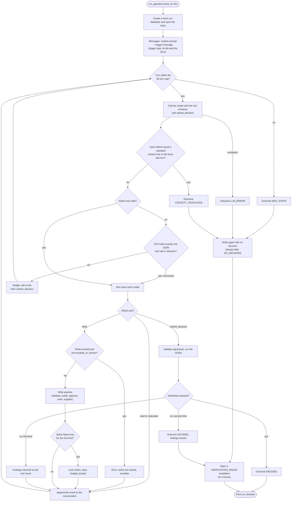

# Architecture

This document describes how the system is put together and why each boundary exists.
For how to run it, see the [README](../README.md).
For how the agent reasons about a purchase, see [approach.md](approach.md).

## Contents

- [Code layout](#code-layout)
- [Components](#components)
- [Why each boundary exists](#why-each-boundary-exists)
- [The write pipeline](#the-write-pipeline)
- [The agent loop](#the-agent-loop)
- [Three feedback loops](#three-feedback-loops)
- [Data model](#data-model)
- [Trace, API and UI](#trace-api-and-ui)

## Code layout

Everything lives under `backend/app/`.
Imports only point downwards, and `import-linter` enforces it (`uv run lint-imports`, also run by `tests/test_architecture.py`).

```text
main.py            entry point (uvicorn app.main:app), loads .env
api | cli          HTTP routes and command-line entry points
evaluation/        scoring, evaluation service, reports, baselines
agent/             types, loop, prompts, model client, verifier, trace, run storage, tools
purchasing/        types, read model, calculations, validator, policy, mock supplier, write pipeline
scenarios/         the mock world and its 11 scenarios
config.py, db.py, serialize.py   settings, SQLite and clock, JSON helpers
```

Three design decisions shape this layout.
Tool files do not own shared logic: the verifier, the scorer and the human-approval API re-use `purchasing/` directly, so they stay independent of what the model can call.
`.env` is loaded only at entry points (`main.py` and `cli/`), never on import.
Settings are read at call time, so tests can swap them.
One lazy import is allowed upwards: `agent/llm.py` imports `evaluation/baselines.py` for demo mode.

## Components



| Component | Responsibility |
|---|---|
| `scenarios/` (`catalog.py`, `builder.py`, `seed.py`) | The mock world. 11 scenarios, each a function that fills a fresh database, plus its trigger and its expected answer. |
| `config.py`, `db.py`, `serialize.py`, `schema.sql` | Settings read at call time, SQLite access, the frozen clock (2026-11-11) and shared JSON helpers. |
| `agent/types.py` | Run outcome, trace event, finding and decision-argument types. |
| `agent/runs.py` | One database file per run in `backend/data/runs/`. |
| `purchasing/context.py` | The only reader for the rules: calculations, validator and policy never touch the database. Loads one node and one SKU into an immutable `SkuContext` with dates already converted to day offsets. |
| `purchasing/types.py` | The frozen dataclasses the rules pass around, such as `SkuContext`. |
| `purchasing/calculations.py` | Pure maths: demand statistics, order-up-to requirement, rounding to case pack and MOQ, day-by-day stock projection, per-constraint quantity limits, the inventory consistency check. |
| `purchasing/validator.py` | Hard rules. Returns every violation at once, each with a code, severity, message and numbers. |
| `purchasing/policy.py` | Authority, separate from validity: a valid PO above $2,000 needs a human. |
| `purchasing/supplier.py` | The mock supplier. The only code that reads the hidden live availability. |
| `purchasing/actions.py` | The write pipeline. The only module that writes business tables. |
| `agent/tools.py` | The tool registry the model sees: 17 tools, typed arguments, JSON schemas from pydantic, and an information category on every read tool. |
| `agent/service.py`, `agent/prompts.py`, `agent/llm.py` | The hand-written loop, the one general system prompt, and the provider-neutral model client. |
| `agent/verifier.py` | Loop 3: independent checks on the final database state. |
| `agent/trace.py` | The single record of a run: ordered JSONL events that the CLI, the UI and the scorer all read. |
| `evaluation/` (`scoring.py`, `service.py`, `report.py`, `baselines.py`) | The evaluation harness. |
| `api/` (`app.py`, `routes.py`, `registry.py`, `types.py`) | FastAPI app: starts runs in a background thread, streams the trace over SSE, serves approvals and eval reports, and serves the built UI. |
| `main.py`, `cli/` | Entry points. `main.py` builds the app for uvicorn, and `cli/` holds `buyer-run`, `buyer-seed`, `buyer-eval` and `buyer-llm-smoke`. |

## Why each boundary exists

| Boundary | Why |
|---|---|
| The model never writes SQL or computes quantities | Language models are good at investigating and weighing trade-offs and bad at arithmetic and hard rules. Maths is a tool (`plan_order`), rules are a validator. |
| Only `purchasing/context.py` reads SQL for the rules (calculations, validator, policy) | Every rule is testable with hand-made numbers and no database, and no SQL leaks into the rules. The write pipeline and the mock supplier run their own queries. |
| Validity (`purchasing/validator.py`) is separate from authority (`purchasing/policy.py`) | A PO can be perfectly legal and still need a human because it is expensive. A held PO must not look like an error. |
| Only `purchasing/actions.py` writes business tables | No path to the database can skip validation, approval, the supplier call or the audit log. |
| The validator cannot see live supplier availability | Catalog data is stale in the real world, and this is what makes the post-action check (loop 2) necessary. |
| Tools never raise on model input | A bad tool name, a missing argument or an unknown SKU comes back as `{"ok": false, "error": ...}`, which the model can fix. A crash teaches it nothing. |
| The run is bound to one node | Every trigger is about one node. Tools take `sku`, never `node_id`, and a PO of another node looks exactly like a missing one. |
| The loop owns the limits | Turn cap, retry budget, truncation guard and verifier retry live in code, not in the prompt, so a confused model cannot talk its way past them. |
| One database per run | The agent writes to the data it is judged on. A shared database would let run 1 change the correct answer to run 2, and scenarios contradict each other on purpose (different budgets, different storage). |
| One trace for everything | What the CLI prints, what the UI streams and what the scorer reads are the same events, so the demo shows exactly what was scored. |

## The write pipeline

Every change to a purchase order goes through the same steps in `purchasing/actions.py`.
Each action is one transaction, and a failure rolls back and returns `NOT_ALLOWED` instead of raising.
Refused attempts are written to the audit log too.



Result statuses the model can see:

| Status | Meaning | What the model should do |
|---|---|---|
| `BLOCKED` | A hard rule failed. Nothing was written. | Read the violations, change the quantity or supplier, try again. |
| `NEEDS_JUSTIFICATION` | Only warnings fired. Nothing was written. | Change the PO or resend it with a justification. |
| `PENDING_APPROVAL` | Valid but above the approval limit. Written, supplier not contacted. | Nothing; a human decides. |
| `WRITTEN` | Written and submitted. The `supplier` block holds the real answer. | Read `confirmed` and `shortfall`; a gap means the problem is not solved. |
| `NOT_ALLOWED` | The action does not apply (wrong PO state, other node, bad parent). | Pick a different action. |

A supplier that rejects the PO outright is reported with `ok: false` at the top level, so the model cannot read it as success.

Validator rules:

| Severity | Codes |
|---|---|
| Error (blocks) | `QTY_NOT_POSITIVE`, `NOT_CASE_MULTIPLE`, `OVER_STORAGE`, `SUPPLIER_NOT_OFFERING`, `SUPPLIER_NOT_APPROVED`, `BELOW_MOQ`, `OVER_SUPPLIER_CAPACITY`, `OVER_BUDGET`, `OVER_SHELF_LIFE`, `PO_NOT_FOUND` |
| Warning (needs a justification) | `EXCESS_COVER` (post-order cover above 2 x the coverage window), `ARRIVES_AFTER_STOCKOUT`, `LOW_RELIABILITY_SUPPLIER` (on-time rate below 80%) |

PO lifecycle:

- `PENDING_APPROVAL` to `SUBMITTED` to `CONFIRMED`, `PARTIALLY_CONFIRMED` or `REJECTED`.
- Any open status to `CANCELLED`.
  Cancelling a confirmed PO gives its units back to the supplier's availability.
- `modify_po` works only on `PENDING_APPROVAL` and `SUBMITTED` POs, because a supplier's confirmation is a commitment.
  After confirmation the agent cancels or adds a top-up PO linked by `parent_po_id`.
- `accept_partial_confirmation` turns a `PARTIALLY_CONFIRMED` PO into `CONFIRMED` at the quantity the supplier can ship.

Approvals are a compare-and-set.
The approve and reject endpoints first claim the escalation with `UPDATE ... WHERE status = 'OPEN'` inside `BEGIN IMMEDIATE`, so two simultaneous decisions can never both win, even across processes.
A second decision gets HTTP 409.

## The agent loop

The loop in `agent/service.py` is hand-written, with no agent framework, so every step is visible and the guardrails sit between the model's tool call and its execution.



| Mechanism | Detail |
|---|---|
| Trigger message | The trigger's type, its own ids (`rec_id`, or `event_id` and `po_id`, or the alert) and the SKU, plus the scenario's `situation` text. No facts are preloaded (D61): every read is the model's own tool call. |
| Turn cap | 30 turns. Reaching it ends the run with `MAX_STEPS`. |
| Retry budget | A failure key is the write tool plus its sorted violation codes (or a supplier shortfall). The third identical key locks every write except `escalate_to_human` for the rest of the run. A model making progress with different fixes is never locked. |
| Truncation guard | If the server reports input tokens equal to a common context size (2048, 4096, 8192, and so on) or lower than the previous turn, the run stops with `CONTEXT_TRUNCATED`. The conversation only grows, so a drop means the server cut the prompt. |
| Text recovery | Some small models write a tool call as JSON text. If the reply holds exactly one JSON object that is a known tool call or a decision, it is executed and traced as `recovered_tool_call`. |
| Nudge | Any other text-only reply gets a short reminder to use the tool interface and to finish with `submit_decision`. |
| One verifier retry | The first failed verification goes back to the model as the tool result. A second failure ends the run and flags it. |
| Run outcomes | `DECIDED`, `MAX_STEPS`, `LLM_ERROR`, `CONTEXT_TRUNCATED`. Every outcome other than a passing `DECIDED` leaves an open `VERIFICATION_FAILED` escalation. |
| `submit_decision` | The terminal tool. Fields: decision (`ACCEPT`, `MODIFY`, `REJECT`, `INVESTIGATE`), `new_units`, `daily_demand_used`, `key_factors`, `actions_taken`, `confidence`, `summary`. It is a structured, checkable answer rather than free text. |

## Three feedback loops

| Loop | Code | Runs | Catches |
|---|---|---|---|
| 1. Pre-action validation | `validator.validate_purchase`, called by `actions._gate` | Before any write | An illegal or unusual PO |
| 2. Post-action outcome check | `purchasing/supplier.py` `submit`, reported by `agent/tools.py` `_action_dict` | After the supplier is contacted | The supplier confirming less than asked, or nothing |
| 3. End-of-run verification | `verifier.verify`, called when the model submits | At `submit_decision`, and again if the run ends without one | The final state not matching the claim or not solving the problem |

### Loop 1: pre-action validation

The validator returns all violations at once, so the model can fix everything in one revision.
The `max_qty` in a violation tells it the largest legal quantity under that rule.
Warnings do not block, but nothing is written until the model resends the call with a `justification`, which is stored in the PO notes and the audit log.

A real example, from a development run of a small local model on S1-MODIFY (run id `20261111T182450-401ff5`).
The free ambient storage for this SKU is 280 units and the case pack is 24.

```text
plan_order {"sku": "SKU-1002", "supplier_id": "SUP-METRO", "daily_demand": 40}
  -> suggested_qty 192, limits {budget 984, storage 264, ...}, binding "storage"

create_po {"sku": "SKU-1002", "supplier_id": "SUP-METRO", "qty": 392, "daily_demand": 40, ...}
  -> status BLOCKED
     "Blocked: 392 is not a multiple of the case pack 24; 392 units exceed the 280 units of free ambient storage"
     violations NOT_CASE_MULTIPLE, OVER_STORAGE (max_qty 264)

create_po {"sku": "SKU-1002", "supplier_id": "SUP-METRO", "qty": 264, "daily_demand": 40, ...}
  -> status WRITTEN, "Supplier confirmed all 264 units of PO-A001."
```

The write pipeline kept the system legal and the model fixed the quantity from the structured error.
Legal is not the same as right: 264 is above the 168 to 240 band the evaluation expects, and the calculator's own suggestion was 192, so the action check would still fail this run.
(That development run ended `MAX_STEPS` because the model kept writing its decision as text instead of calling `submit_decision`.
The loop has since gained text recovery for exactly this.)

### Loop 2: post-action outcome check

The validator knows what a real buyer knows from the catalog.
The supplier's confirmation is the truth, and the mock supplier decides it from a hidden `supplier_live_availability` table.
In S2-ALT-ALSO-SHORT the catalog lists 1,000 units for QuickSupply, the validator accepts an order of 90, and the supplier confirms only 40.

The tool result carries the real answer, and the prompt tells the model that what the supplier confirms is what will arrive and that a need not yet met means it must keep working or escalate: typically a top-up from another approved supplier (optionally linked with `parent_po_id`).
A shortfall also counts toward the retry budget, so a model that keeps ordering from a supplier that keeps coming up short is eventually locked into escalating.

The real example is in the [README](../README.md#a-real-example): `create_po` for 180 units from QuickSupply returned `PARTIALLY_CONFIRMED`, 40 of 180, short by 140.

### Loop 3: end-of-run verification

`verify` trusts the database, not the model's story.
It checks the final state and returns findings:

| Code | Raised when |
|---|---|
| `PO_INVALID` | A PO the agent created or modified no longer passes the validator at the demand the agent recorded for it. |
| `UNRESOLVED_SHORTFALL` | A touched PO is `PARTIALLY_CONFIRMED` and the gap is neither covered by a top-up PO (one linked to it or placed after it for the same SKU) nor escalated. Whether the top-ups are big enough is `STOCKOUT_UNRESOLVED`'s job. |
| `NO_DECISION` | The run ended without a `submit_decision`. |
| `CLAIM_MISMATCH` | `new_units` in the decision differs from the units the database expects to arrive (confirmed quantity where the supplier answered). |
| `STOCKOUT_UNRESOLVED` | At the demand the agent used (or the forecast mean), the projected stockout falls before the next review and the agent raised no escalation. |
| `DECISION_ACTION_MISMATCH` | `REJECT` or `INVESTIGATE` with units bought, `INVESTIGATE` without an `INVESTIGATION` escalation, or `MODIFY` when no PO was created, resized or cancelled. |

Findings are sent back to the model once.
If it fixes them, the run passes.
If not, the run ends and a `VERIFICATION_FAILED` escalation is opened for a human.

The README example shows a second use: the model escalated, then submitted `REJECT` with `new_units` 0, while the database held a PO that would deliver 40 units.
The verifier returned `CLAIM_MISMATCH` and `DECISION_ACTION_MISMATCH`, and the model resubmitted `MODIFY` with 40.

## Data model

SQLite, raw SQL, 17 tables.
`schema.sql` is the source of truth.

| Group | Tables | Notes |
|---|---|---|
| Run metadata | `meta` | Scenario id, run id and the frozen "today". |
| Master data | `nodes`, `products`, `suppliers`, `supplier_products` | Products carry case pack, shelf life, review period and safety days. Suppliers carry on-time rate, fill rate and approval. `supplier_products` holds cost, MOQ, lead time and the catalog's listed capacity. |
| Hidden truth | `supplier_live_availability` | What a supplier can really ship. No read tool and no validator rule can see it. Only `purchasing/supplier.py` reads it. |
| Operational data | `inventory`, `sales_history`, `forecasts`, `promotions`, `storage_capacity`, `budgets` | Each maps to one information category the buyer needs. |
| Documents | `purchase_orders`, `recommendations`, `supplier_events` | One SKU per PO. `parent_po_id` links a top-up to its origin. Recommendations are the upstream engine's output and are not assumed correct. |
| Human in the loop | `escalations` | Kinds: `APPROVAL` (from the pipeline), `INVESTIGATION`, `BUDGET_INCREASE`, `SUPPLIER_ISSUE`, `OTHER` (from the agent), `VERIFICATION_FAILED` (from the verifier). |
| Audit | `audit_log` | Append-only: who (`agent`, `supplier_api`, `human`, `verifier`), what, which entity, and the details, including refused attempts. |

Derived quantities the purchasing core computes from these tables:

- Budget remaining is the category budget minus spent to date minus the value of every open PO in the category (confirmed quantity where known).
- Free storage is the zone capacity minus other SKUs minus this SKU's on-hand minus all inbound, as if everything lands before anything sells.
  This is conservative on purpose.
- An open PO is one in `PENDING_APPROVAL`, `SUBMITTED`, `CONFIRMED` or `PARTIALLY_CONFIRMED`.

Every read tool maps to one information category (`inventory`, `sales_history`, `forecast`, `promotions`, `open_pos`, `suppliers`, `budget`, `storage`, `supplier_events`), so "did the agent gather the necessary information" is a set comparison in the evaluation.

## Trace, API and UI

Every run emits ordered events to a JSONL file and to a live callback.
Event types: `run_started`, `llm_request`, `llm_response`, `tool_call`, `tool_result`, `harness_step`, `nudge`, `recovered_tool_call`, `budget_locked`, `decision`, `verification`, `flagged`, `error`, `run_finished`.
Tool events carry `by: "agent"`.
Runs saved before D61 also hold preload reads with `by: "harness"` in turn 0, and the UI still shows them under a "Preload context" span.
`llm_request` is emitted before every model call and holds only the messages added since the previous request, plus `message_count`.
The first request also holds the full tool list, which never changes during a run.
The UI rebuilds the full input of generation N by joining the messages of requests 1 to N.
`llm_response` also carries the model name, the finish reason and the token counts per turn, which is what exposed the context-truncation problem described in [evaluation.md](evaluation.md).
`harness_step` records what the code did around one agent tool call (`stage`, `status`, `detail`, and `requested` and `confirmed` for the supplier).
The first step is always `request`: the code checks the model's request before anything runs, and records `ACCEPTED` (known tool, valid arguments), `REJECTED` (with the reason: invalid JSON, unknown tool or invalid arguments) or `LOCKED` (writes are locked after the retry limit).
A rejected or locked request runs nothing.
A write that passes the check then adds `validator`, `approval` and `supplier` steps.
The agent loop removes the write steps from the tool result before it is traced or sent to the model, so the tool message the model sees is unchanged.
The UI follows the Langfuse layout (D59, D62): a tree of the run, its LLM calls, the tool calls each one asked for, and their steps (request, validator, approval, supplier, and the verifier for `submit_decision`).
Selecting an LLM call shows its full input as the model received it: the tool list first, then every message so far (system, user, assistant with its tool calls, tool results), each collapsible, with the messages added since the previous call marked "new".
The output is the assistant's reply.
A Formatted/JSON toggle shows the raw request and response.

Files in `backend/data/runs/` (git-ignored):

- `<scenario>__<run_id>.db`: the run's database.
- `<scenario>__<run_id>.trace.jsonl`: the trace.
- `<scenario>__<run_id>.api.json`: a small sidecar (model, scorecard) written for runs started through the API, so a restarted server can still show them.

HTTP API (`api/`, no business logic):

| Endpoint | Purpose |
|---|---|
| `GET /api/health` | Model name, whether it is local, and whether the API is in demo mode. |
| `GET /api/scenarios` | The 11 scenarios with their expected answers. |
| `POST /api/runs` with `{"scenario_id": ...}` | Starts a run in a background thread and returns its id. Responds 503 if the model client cannot be built, for example when no key is set. |
| `GET /api/runs`, `GET /api/runs/{run_id}` | Run list (newest first, at most 50) and the full summary: decision, verification, scorecard, purchase orders, escalations, totals. |
| `GET /api/runs/{run_id}/events` | Server-Sent Events. Replays from the first event, then follows live, then sends `event: end`. |
| `POST /api/runs/{run_id}/escalations/{escalation_id}/approve` and `/reject` | Human decision on a held PO. Returns 409 if the run is still working or the escalation is not an open approval. |
| `GET /api/eval` | The committed reports from `docs/eval/*.json`, summarised by the same code that wrote their Markdown. |

Server-Sent Events fit because the UI only needs a one-way stream of trace events, and a late subscriber can replay from the start.
Each run is one background thread with an in-process registry, which is enough for a single-user demo.
`LLM_MODEL=baseline:rubber_stamp` (or `baseline:do_nothing`) makes the API drive runs with a baseline policy instead of a model, with the same tools, pipeline, verifier and scorer.

The UI (`frontend/`, Vite, React, TypeScript, Tailwind) has two tabs.
Run shows the scenario, a loop strip (which of the three loops fired and how it ended), the live trace, the decision next to the expected answer, the six checks, the purchase orders, and a "Waiting for you" queue with Approve and Reject buttons.
Eval shows every report in `docs/eval/` side by side with a per-scenario matrix.
