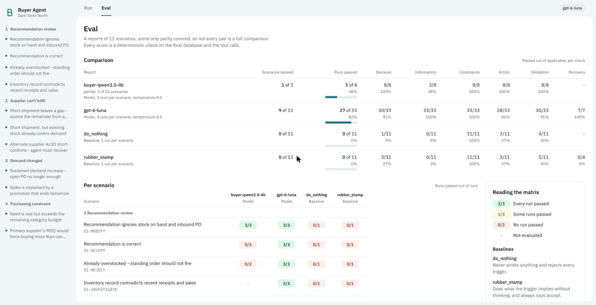
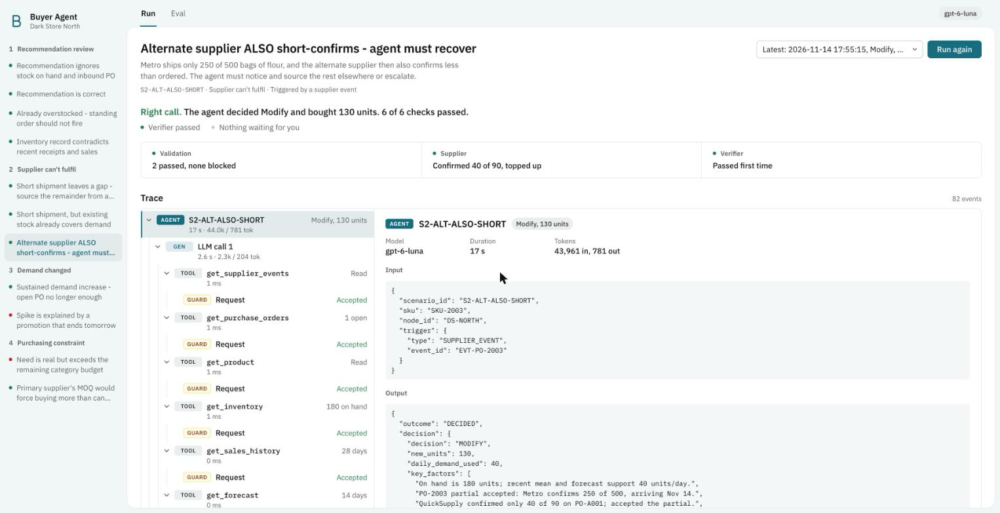
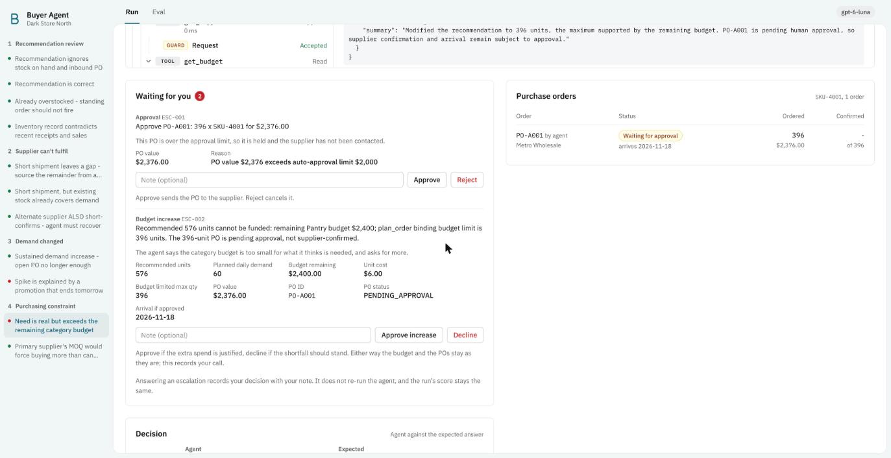

# Demo: a three-minute walk-through

This script shows the three feedback loops, the human approval step and the evaluation, in the order a grader would want to see them.
Part 1 needs no model and no key.
Part 2 needs a real model (see "Running with a real model" in the [README](../README.md)), because two things only a real model produces cannot be faked by the demo policy: a recovery after a supplier comes up short, and a valid purchase order above the approval limit.

## Before you start

Start the app in demo mode with either option from the README quick start.
For one process:

```bash
cd frontend && npm ci && npm run build
cd ../backend && uv sync
LLM_MODEL=baseline:rubber_stamp uv run uvicorn app.main:app --port 8000
```

Open http://localhost:8000.
The top bar and the sidebar footer show a "Demo: rubber-stamp policy" badge.
In demo mode each Run click drives the real tools, validator, write pipeline, verifier and scorer with a naive policy that does what the trigger says and always answers accept.
It stands in for a model that does not think, which is useful because it shows what the system does with a bad agent.

If the page says "Can't reach the API", the backend is not running or is on another port.
If starting a run returns an error about `LLM_MODEL` or `LLM_API_KEY`, the server was started without `LLM_MODEL=baseline:rubber_stamp` and no model or key is configured.

## Part 1: demo mode (about two minutes)

### 1. Loop 1, the validator (S1-MODIFY)

Select "Recommendation ignores stock on hand and inbound PO" under group 1 and press Run.

What to look at:

- The trace starts with LLM call 1: the policy reads the recommendation and the sales history itself.
Nothing is preloaded.
- Select an LLM call to see exactly what it was sent: the tools, then every message so far, with the new ones marked.
- The policy tries to buy the recommended 800 units, and the write comes back `BLOCKED`: not a multiple of the case pack of 24, and above the 280 units of free ambient storage.
  The block lists every violation at once with the numbers.
  The policy does not revise, but a real model reads this and changes the quantity.
- The policy then submits `ACCEPT`, and the verifier answers: at the demand used, the stock runs out on day 10, before the next review, and no escalation was raised.
  It gets one retry, fails again, and the run is flagged.
- The loop strip under the title shows the validation loop and the verifier loop with how each ended.
- "Waiting for you" now holds a verification-failed item: the system refused to let a bad run pass quietly.
- On the decision card the agent's answer (`ACCEPT`) sits next to the expected one (`MODIFY`, 168 to 240 units), and the checks list a reason for every failure.

Talking point: the model cannot create an illegal purchase order, and the evaluation still marks this run wrong, because legal is not the same as right.

### 2. Legal but wrong (S3-PROMO-ENDING)

Select "Spike is explained by a promotion that ends tomorrow" under group 3 and press Run.

- The policy plans off the 7-day mean, which a promotion ending tomorrow has inflated, and places a valid purchase order for 480 units that the supplier confirms.
- `constraints` passes and `validation` passes, but `action` fails: the new-buy units are far above the expected 0.
- This is the case for judging the decision and not only the rules.

### 3. The Eval tab

Open Eval.

- The two baselines are scored on all 11 scenarios by the same code that scored the run you just watched.
- Neither passes a single scenario.
- `constraints` is 11 of 11 for both, because the guardrails block illegal orders and a policy that never writes cannot break a rule.
- `decision` and `action` are where they fail, which is where a model has to earn its score.
- Model reports appear here alongside the baselines when they are in `docs/eval/`.



## Part 2: with a real model (about one minute)

Stop the server and start it without the `LLM_MODEL=baseline:...` prefix, with the endpoint, key and model from `.env` (see the README).
The badge now shows the model name.

### 4. Loop 2, the supplier says less (S2-ALT-ALSO-SHORT)

Select "Alternate supplier ALSO short-confirms - agent must recover" under group 2 and press Run.

What to look at:

- The trigger is a supplier message: Metro can ship only 250 of 500 units.
- The agent reads suppliers, budget and storage, plans an order, and creates a PO with an approved alternate supplier.
  The validator accepts it, because the catalog says QuickSupply has 1,000 units.
- The tool result carries the supplier's real answer: confirmed 40, short by the rest.
  The loop strip shows "Supplier: Confirmed 40 of ..." and whether the shortfall was made up.
- A good run tops up from another approved supplier (Rapido) with `parent_po_id` set, and the verifier passes.
  A run that escalates instead is recorded as a weaker answer by the `action` check, because Rapido could have covered the gap.
- If the agent claims units the database does not hold, the verifier says so once and the agent can correct it.



### 5. Human approval (S4-BUDGET)

Select "Need is real but exceeds the remaining category budget" under group 4 and press Run.

What to look at:

- The recommendation is for 576 units, which would cost more than the remaining Pantry budget, so the validator blocks any attempt to buy it as it stands.
- A good run buys what the budget allows (up to 396 units, 33 cases) and raises a `BUDGET_INCREASE` escalation for the rest.
- That purchase is worth more than $2,000, so it is written as "Waiting for approval" and the supplier is not contacted.
- "Waiting for you" lists the purchase order with Approve and Reject buttons once the run has finished.
  Press Approve: the supplier is contacted, its answer comes back, and the purchase order moves to confirmed.
  Reject would cancel it without the supplier ever seeing it.
- A second click, or a decision from another tab, gets a conflict message, because approvals are a guarded one-shot update.



## Where to look afterwards

- The trace of any run is in `backend/data/runs/<scenario>__<run_id>.trace.jsonl`, and the run's database is next to it.
  Open the database with `sqlite3` and read `audit_log` to see every change, including refused attempts.
- `cd backend && uv run buyer-run S1-MODIFY` prints the same trace in the terminal with a real model configured, or with the `LLM_MODEL=baseline:rubber_stamp` prefix for the demo policy.
- [evaluation.md](evaluation.md) explains the checks, and [architecture.md](architecture.md) shows the write pipeline and the agent loop.
